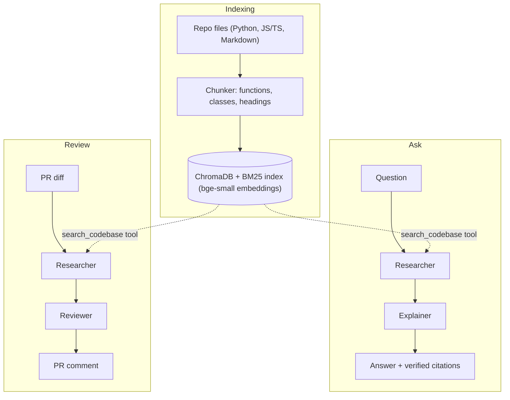

# RepoPilot

A multi-agent AI teammate for GitHub repos, built with **CrewAI** and **RAG** on a **free stack**.

- **Ask** questions about a codebase and get answers with `file:start-end` citations.
- **Review** pull requests automatically: one comment per PR, updated on every push.

Everything runs on free tiers: Gemini or Groq for the LLM, local `bge-small` embeddings, a local ChromaDB index, and GitHub Actions for PR automation (no server to host).

## Quickstart

Requires **Python 3.11 to 3.13** (CrewAI does not support 3.14 yet) and a free [Gemini API key](https://aistudio.google.com/).

```bash
git clone https://github.com/YOUR_USERNAME/repopilot.git && cd repopilot
python3.12 -m venv .venv && source .venv/bin/activate    # Windows: .venv\Scripts\Activate.ps1
pip install -e .
cp .env.example .env                                      # Windows: copy .env.example .env, then set GEMINI_API_KEY
python -m repopilot index . && python -m repopilot ask "How does indexing work?"
```

The first `index` run downloads the embedding model (about 130 MB). To work on a different repo, run `python -m repopilot index /path/to/repo`.

## Browser interface

Install the GUI extra and start the Streamlit app from the project directory:

```bash
pip install -e ".[gui]"
python -m streamlit run src/repopilot/gui.py
```

The browser interface supports indexing a repository, asking questions, searching indexed code, and reviewing a pasted or uploaded diff. Configure the LLM provider in `.env` as described below. The existing command-line interface remains available.

## Commands

| Command | What it does |
|---|---|
| `python -m repopilot index <repo_path>` | Chunk the repo and build the local index (replaces any existing index) |
| `python -m repopilot ask "question"` | Researcher then Explainer; prints the answer, the cited sources, and a warning for any citation that matches no retrieved code |
| `python -m repopilot review --diff pr.diff` | Researcher then Reviewer; prints the review as markdown (`--diff -` reads stdin) |
| `python -m repopilot review --diff pr.diff --post-comment --repo owner/name --pr 12` | Same, and posts or updates a PR comment (needs `GITHUB_TOKEN`) |
| `python -m repopilot search "query" -k 6` | Debug: show the top retrieved chunks without calling an LLM |

`review` also accepts `--markdown-out review.md` to save the comment text.

## How it works



- **Chunking:** Python is split with `ast`, JS/TS with a regex splitter, Markdown by heading; each chunk keeps its file path and line range. Lockfiles, binaries, build folders, and files over 500 KB are skipped.
- **Retrieval:** vector search and BM25 are merged with reciprocal rank fusion, returning the top 6 chunks.
- **Agents** (prompts live in `src/repopilot/config/*.yaml`):
  - *Researcher* searches the index and reports citations plus key lines.
  - *Explainer* answers only from those notes and cites every claim.
  - *Reviewer* returns JSON findings (file, line, severity, issue, suggestion) and a verdict.
- **Guardrails:** citations are checked against retrieved code; a high-severity finding forces the verdict to "changes requested"; findings about files the model never saw are dropped; large diffs are cut file by file and the omitted files are listed in the comment.

## Add the PR reviewer to any repo

1. Push RepoPilot to GitHub (public is simplest, because the Action installs it with `pip install git+https://...`).
2. Copy `.github/workflows/repopilot-review.yml` into the target repo and replace `YOUR_USERNAME` in `REPOPILOT_PIP_SPEC`. (Inside the RepoPilot repo itself, set it to `"."`.)
3. In the target repo, add a secret `GEMINI_API_KEY` (Settings, Secrets and variables, Actions).
4. Open a pull request. A comment appears after a few minutes; later pushes update the same comment.

Notes:

- **Groq instead of Gemini:** add a `GROQ_API_KEY` secret and a repo *variable* `LLM_MODEL` such as `groq/<model-name>`.
- **Fork PRs are skipped.** They get no secrets and a read-only token, so the bot could not comment anyway, and it keeps outsiders from using your key.
- **No comment?** The review step is set to `continue-on-error` so a rate-limited free tier does not put a red X on every PR. Open the job logs to see why.
- The workflow only needs `contents: read` and `pull-requests: write`.

## Configuration

Set in `.env` (see `.env.example`) or as environment variables:

| Variable | Default | Purpose |
|---|---|---|
| `LLM_MODEL` | `gemini/gemini-2.5-flash` | LiteLLM-style model name. Free-tier model names change, so check your provider's current list |
| `GEMINI_API_KEY` / `GROQ_API_KEY` | none | Key for your provider (Ollama models need none) |
| `LLM_MAX_RETRIES` | `5` | Retries with exponential backoff on rate-limit errors |
| `EMBEDDING_MODEL` | `BAAI/bge-small-en-v1.5` | Local sentence-transformers model |
| `CHROMA_DIR` | `.repopilot/chroma` | Where the index is stored |
| `TOP_K` | `6` | Chunks returned per search |
| `MAX_DIFF_CHARS` | `24000` | Diff size limit for reviews |
| `REPOPILOT_CONFIG_DIR` | built-in | Folder with your own `agents.yaml` / `tasks.yaml` |
| `LOG_LEVEL` | `INFO` | Logging verbosity |

## Free-tier limits

Free tiers change often, so check each provider's pricing page for current numbers. What to expect:

- **LLM rate limits** are the main constraint (requests per minute and per day). One `ask` or `review` makes roughly 3 to 6 LLM calls. RepoPilot retries with backoff and stops with a clear message if the limit persists. Switch `LLM_MODEL` to another free provider if you hit a daily cap.
- **Model quality:** small free models sometimes skip the search tool or ignore the citation format. The unverified-citation warning and the JSON fallback exist for this reason.
- **GitHub Actions** minutes are free for public repos; private repos have a monthly allowance. The first run is the slowest (dependency and model downloads); later runs use the Actions cache.
- **Embeddings and ChromaDB** are local, so they cost nothing and send no code to a third party. The Researcher and Reviewer do send retrieved snippets and the diff to your chosen LLM provider.

## Project layout

```
src/repopilot/
  ingest.py          repo walking and chunking
  rag.py             embeddings, ChromaDB store, hybrid search
  agents.py          CrewAI agents, retriever tool, ask and review flows
  diffs.py           diff splitting, size budget, line numbering
  github_comment.py  markdown formatting and PR comment upsert
  schemas.py         Pydantic models (Chunk, ReviewReport, ...)
  settings.py        environment configuration
  cli.py             command line interface
  gui.py             Streamlit browser interface
  ui.css             browser interface styling
  config/            agents.yaml and tasks.yaml (prompts)
.streamlit/
  config.toml        Streamlit theme
tests/               LLM calls are mocked
.github/workflows/repopilot-review.yml
```

## Development

```bash
pip install -e ".[dev]"
python -m pytest -q
```

The tests use a fake embedder and a scripted LLM, so they need no network, API key, or model download.

## Known limitations

- `index` rebuilds the whole index each time; incremental re-indexing is not implemented. In the Action, the index is cached per exact code state.
- The index is built from the PR's merged tree, so retrieved context can include the changed code itself.
- JS/TS chunking is regex-based (top-level declarations only), and very large Python classes are split into line windows rather than per method.
- The PR diff is untrusted input. The prompts tell the model to ignore instructions inside it, but treat the review as advice, not a gate.

## Troubleshooting

- **`ModuleNotFoundError`:** run commands with the venv's Python (`python -m ...`) and make sure `pip install -e .` finished without errors.
- **pip cannot find `crewai`:** your Python is 3.14 or older than 3.11; create the venv with Python 3.12.
- **"No API key found":** set the key for your provider in `.env`.
- **"Nothing is indexed yet":** run `python -m repopilot index <path>` first, from the same folder you run `ask` in (the index lives in `.repopilot/chroma`).
- **PowerShell blocks venv activation:** run `Set-ExecutionPolicy -Scope Process RemoteSigned` and try again.
